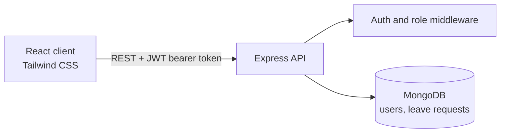
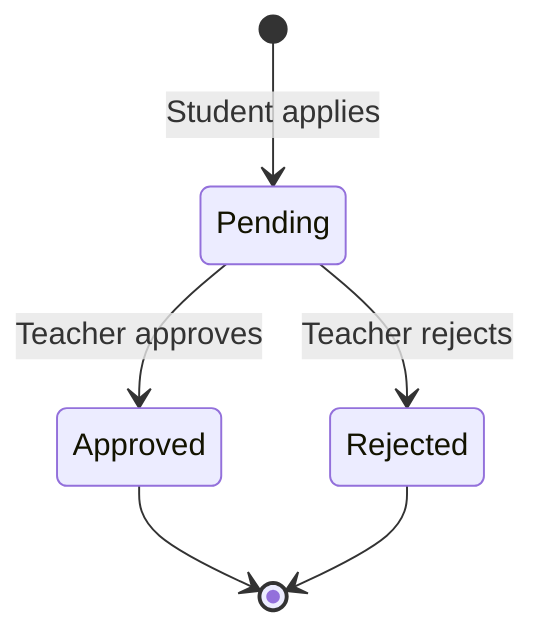

# EduLeave

**Leave management system for engineering colleges, built with React, Node.js/Express, and MongoDB**

[](https://react.dev)
[](https://expressjs.com)
[](https://www.mongodb.com)
[](https://tailwindcss.com)

---

<!--
## Demo
Add screenshots to docs/ and link them here, for example:

-->

## Overview

EduLeave replaces paper forms, emails, and chat messages for student leave. Students apply online, the class teacher approves or rejects, and admins (HOD / Principal) get a read-only view of leave activity across the college.

**Domain:** Education / Campus administration
**Stack:** React 18, Tailwind CSS 3, Express 4, MongoDB (Mongoose 7)
**Status:** Core flows implemented for all three roles, under active improvement

## Motivation

Most colleges still handle leave through paper, email, or messaging apps. Records get lost, nobody can see how many leaves a student has taken, and the leave policy is applied by hand. EduLeave puts the policy in code (monthly limits, required reason, no edits after submission) so it is applied the same way every time.

---

## How It Works



A leave request moves through one workflow. Once a teacher acts on it, it cannot be changed.



---

## Features

**Everyone**

- Register and log in with email and password (minimum 8 characters)
- JWT sessions that expire after 24 hours, passwords hashed with bcrypt
- Role-based access (Student, Teacher, Admin) on both API routes and frontend routes

**Student**

- Apply for a regular or emergency leave with a date range and a reason
- Leave history with month and status filters
- Status tracking: Pending, Approved, Rejected

**Teacher**

- See pending requests from students in their assigned class
- Approve or reject with a confirmation prompt
- Requests that were already processed cannot be processed again

**Admin**

- Summary cards: total leaves, approved leaves, approval rate, emergency leaves
- All leave requests across classes, filter by status, search by student name
- Pagination (10 per page)

**Leave rules enforced by the API**

- Monthly limit of 3 regular and 1 emergency leave per student, counted by the month the leave starts (pending and approved requests both count)
- Reason is required and must be at least 10 characters
- Start date cannot be in the past, end date cannot be before the start date

---

## Tech Stack

| Layer      | Technology                                                 |
| ---------- | ---------------------------------------------------------- |
| Frontend   | React 18, React Router 6, Tailwind CSS 3, Create React App |
| Backend    | Node.js, Express 4                                         |
| Database   | MongoDB with Mongoose 7                                    |
| Auth       | JWT (`jsonwebtoken`), bcrypt                               |
| Validation | `express-validator` on the API, inline checks in the forms |
| API calls  | Browser Fetch API                                          |

---

## Getting Started

### Prerequisites

- Node.js (v16 or newer recommended)
- A MongoDB database (local, or a free MongoDB Atlas cluster)

### 1. Clone

```bash
git clone https://github.com/SiddarthReddyK/leave-app.git
cd leave-app
```

### 2. Backend

```bash
cd backend
npm install
```

Create `backend/.env`:

```
PORT=5000
MONGODB_URI=<your MongoDB connection string>
JWT_SECRET=<a long random string>
```

Start the API:

```bash
npm run dev
```

The API runs on <http://localhost:5000>. Opening it in a browser returns a short "server is running" message.

### 3. Frontend

In a second terminal:

```bash
cd frontend
npm install
```

Create `frontend/.env`:

```
REACT_APP_API_URL=http://localhost:5000
```

Start the app:

```bash
npm start
```

Open <http://localhost:3000>.

### 4. Create accounts

Use the Register page and pick a role. To try the full flow, register one student and one teacher with the **same class name** (for example `CS-A`), plus one admin. Teachers only see requests from students whose class matches theirs.

---

## API Reference

All routes except register and login need an `Authorization: Bearer <token>` header.

| Method | Endpoint                       | Role    | Description                                                                 |
| ------ | ------------------------------ | ------- | --------------------------------------------------------------------------- |
| POST   | `/api/auth/register`           | Public  | Create an account                                                           |
| POST   | `/api/auth/login`              | Public  | Log in, returns a token and user                                            |
| GET    | `/api/auth/me`                 | Any     | Current user                                                                |
| POST   | `/api/leaves/apply`            | Student | Submit a leave request                                                      |
| GET    | `/api/leaves/my-leaves`        | Student | The student's own requests                                                  |
| GET    | `/api/leaves/balance`          | Student | Remaining regular and emergency leaves                                      |
| GET    | `/api/leaves/pending`          | Teacher | Pending requests for the teacher's class                                    |
| PUT    | `/api/leaves/:leaveId/approve` | Teacher | Approve or reject (`status`: `approved` or `rejected`, optional `comments`) |
| GET    | `/api/leaves/all`              | Admin   | All requests, optional `status` and `classFilter` query params              |
| GET    | `/api/leaves/stats`            | Admin   | Totals and approval rate                                                    |

---

## Project Structure

```
leave-app/
├── backend/
│   ├── src/
│   │   ├── controllers/      # authController (register, login, current user)
│   │   ├── middleware/       # JWT auth, role check, request validators
│   │   ├── models/           # User, LeaveRequest
│   │   ├── routes/           # authRoutes, leaveRoutes
│   │   └── server.js         # Express entry point, MongoDB connection
│   └── package.json
├── frontend/
│   ├── public/
│   ├── src/
│   │   ├── components/       # Reusable UI pieces (for example DatePicker)
│   │   ├── pages/            # Landing, Login, Register, Student / Teacher / Admin dashboards, ApplyLeaveForm
│   │   ├── styles/
│   │   ├── App.js            # Routes and role-protected routes
│   │   └── index.js
│   ├── tailwind.config.js
│   └── package.json
└── docs/
    ├── prd.md                # Product requirements
    ├── design doc.md         # UI design and style guide
    ├── tech stack.md         # Why this stack
    └── todo-list.md          # Build checklist
```
